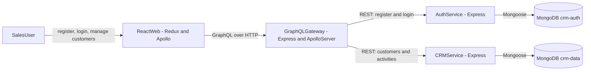
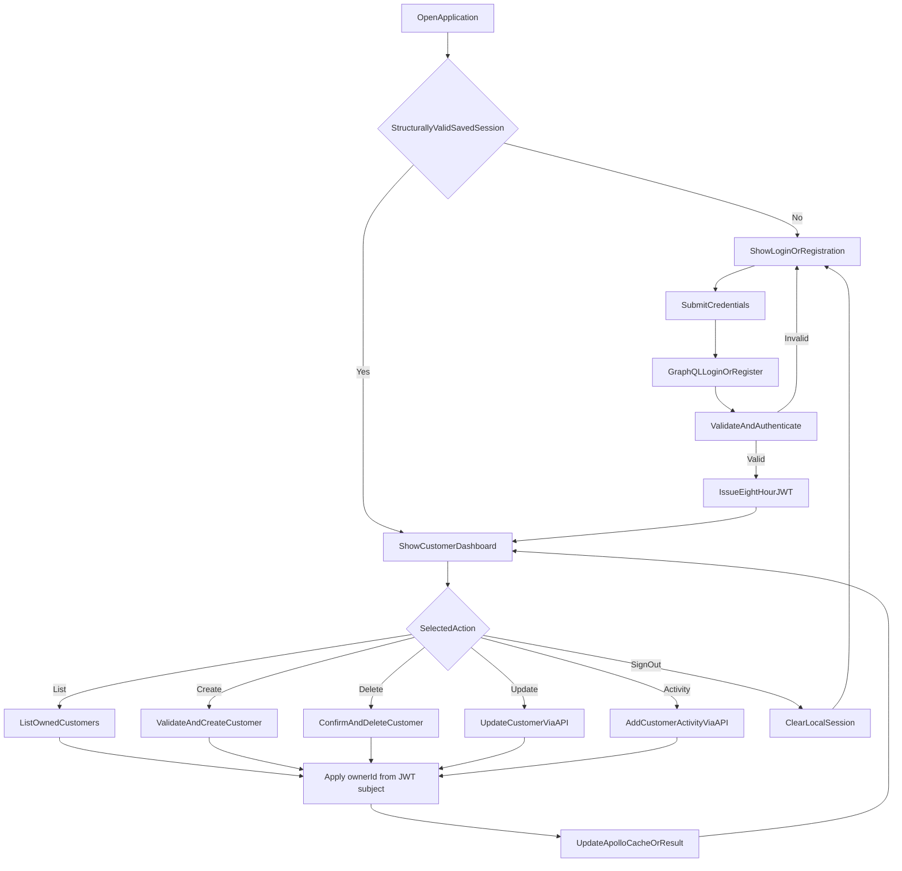
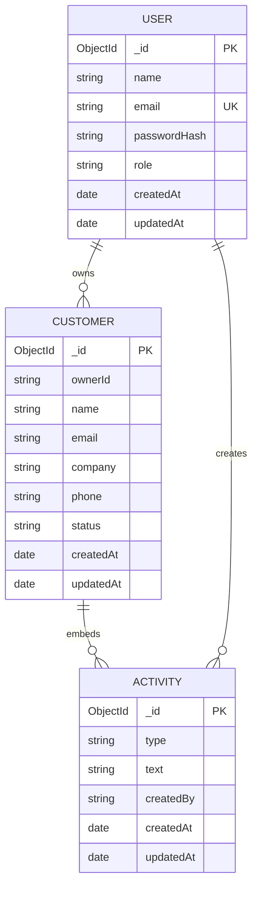

# Atlas Production CRM

Atlas is a CRM monorepo (npm workspaces) with a React frontend, a GraphQL API gateway, and separate auth and CRM services backed by MongoDB. It also includes Docker, tests, GitHub Actions, and Terraform for AWS.

What works today:

- Register / login (bcrypt + JWT)
- Per-user customer isolation
- Create, list, and delete customers in the UI
- Update customers and add activities via the API
- Statuses: `lead`, `active`, `inactive`
- Activity types: `note`, `call`, `email`, `meeting`
- Local run with npm or Docker Compose
- Lint, format, test, build, audit, and infra checks in CI
- Deploy to AWS ECS Fargate

> Longer write-up (design choices, data model, security notes, limitations):
> [docs/PROJECT_RESEARCH.md](docs/PROJECT_RESEARCH.md).

## Table of contents

1. [System overview](#system-overview)
2. [Technology stack](#technology-stack)
3. [Repository structure](#repository-structure)
4. [Architecture](#architecture)
5. [Business logic](#business-logic)
6. [Application components](#application-components)
7. [Data model](#data-model)
8. [API surface](#api-surface)
9. [Security model](#security-model)
10. [Local development](#local-development)
11. [Configuration](#configuration)
12. [Testing and quality](#testing-and-quality)
13. [Docker architecture](#docker-architecture)
14. [AWS deployment](#aws-deployment)
15. [Known limitations](#known-limitations)

## System overview

Request path:

1. Browser loads the React SPA.
2. Apollo Client talks GraphQL to the API gateway.
3. Gateway checks auth, then calls internal REST services.
4. Auth service owns users, password hashes, and JWT issuance.
5. CRM service owns customers and embedded activities.
6. MongoDB holds auth and CRM data in separate databases.

The browser never hits MongoDB or the internal services directly. In Docker/AWS, only the web app and gateway should be public.

## Technology stack

| Area            | Technology                           | Purpose                                 |
| --------------- | ------------------------------------ | --------------------------------------- |
| Monorepo        | npm workspaces                       | Apps + shared packages                  |
| Frontend        | React 18 + TypeScript                | UI                                      |
| Build tool      | Vite 5                               | Dev server and frontend build           |
| Client state    | Redux Toolkit                        | Auth session                            |
| Server state    | Apollo Client                        | GraphQL + cache                         |
| Public API      | GraphQL + Apollo Server              | Browser-facing API                      |
| Gateway runtime | Express 4                            | HTTP + middleware                       |
| Internal APIs   | Express REST                         | Gateway ↔ services                      |
| Authentication  | JWT HS256 + bcryptjs                 | Identity and password hashing           |
| Validation      | express-validator                    | Input checks at service boundaries      |
| Persistence     | MongoDB 7 + Mongoose 8               | Users, customers, activities            |
| Shared domain   | `@crm/shared`                        | Statuses, roles, activity types, limits |
| Tests           | Vitest, Supertest, Testing Library   | Unit, HTTP, component tests             |
| Code quality    | ESLint + Prettier                    | Lint and format                         |
| Containers      | Docker + Docker Compose              | Local and production images             |
| Cloud           | AWS ECS Fargate, ALB, ECR, Cloud Map | Runtime and routing                     |
| Operations      | CloudWatch + Secrets Manager         | Logs, alarms, secrets                   |
| Infrastructure  | Terraform                            | AWS provisioning                        |
| CI/CD           | GitHub Actions + AWS OIDC            | Checks and deploy                       |

## Repository structure

```text
production-crm/
├── apps/
│   ├── web/                 React, Redux, Apollo
│   ├── api-gateway/         Public GraphQL API
│   ├── auth-service/        Register, login, JWT
│   └── crm-service/         Customers and activities
├── packages/
│   └── shared/              Shared domain constants
├── docs/
│   ├── API.md               Internal API notes
│   ├── AWS_DEPLOYMENT.md    AWS setup / deploy
│   └── PROJECT_RESEARCH.md  Longer project notes
├── infra/
│   └── terraform/           ECS, ALB, ECR, etc.
├── .github/
│   ├── workflows/ci.yml
│   ├── workflows/deploy-aws.yml
│   └── dependabot.yml
├── docker-compose.yml
├── package.json
└── README.md
```

## Architecture

### Logical architecture



### Why GraphQL and REST

The browser gets one GraphQL API. The gateway is a BFF: it hides service URLs and the internal REST shape. Auth and CRM stay as small REST services so they can be built, tested, and deployed on their own.

### Who owns what

- Redux: `user` + `token`
- `localStorage` key `crm.session`: session persistence (shape-checked on boot; the client does not re-verify the JWT)
- Apollo: customer queries and cache updates after mutations
- Auth service: user records
- CRM service: customers and activities
- Gateway: no database

## Business logic

### End-to-end flow



### Registration

1. User submits name, email, password.
2. Client sends the `register` mutation.
3. Gateway forwards to `POST /register`.
4. Auth service validates fields and normalizes email.
5. Rejects duplicate emails.
6. Hashes password with bcrypt (cost 12).
7. Stores user with default `sales` role.
8. Signs an HS256 JWT (8h expiry).
9. Client validates the response and stores the session.

### Login

1. User submits email + password.
2. Auth service looks up the normalized email.
3. bcrypt compares against the stored hash.
4. Bad credentials get the same generic error (less account enumeration).
5. Good credentials get a new JWT and public user object.

### Customer management

CRM routes need a bearer token. The CRM service verifies the JWT again even though the gateway already did. Every DB query scopes with `ownerId: req.user.sub`, so users only see their own customers.

On write, only these fields are accepted:

- `name`
- `email`
- `company`
- `phone`
- `status`

IDs, ownership fields, and activity arrays from the client are ignored (mass-assignment / ownership transfer protection).

### Activities

Activities live embedded on the customer document: type, text, creator ID, timestamps. Cap is 200 per customer. GraphQL can add activities; the UI does not expose that yet.

## Application components

### Web application

Location: `apps/web`

- `src/main.tsx` — Redux + Apollo providers, attaches JWT to requests
- `src/App.tsx` — auth screen vs dashboard
- `src/AuthScreen.tsx` — login / register
- `src/Dashboard.tsx` — list, create, delete customers
- `src/authSlice.ts` — session validate + persist
- `src/apolloCache.ts` — Apollo cache config
- `src/ErrorBoundary.tsx` — catches render failures
- `src/types.ts` — frontend / GraphQL types

UI basics: labels, live regions for status/errors, focus styles, loading state, empty state, delete confirm.

### API gateway

Location: `apps/api-gateway`

- `/graphql` and `GET /health` (browser uses GraphQL over HTTP POST)
- Helmet, CORS, JSON body limits
- Verifies HS256 tokens and builds GraphQL context
- Turns bad/missing auth into GraphQL errors
- Calls upstreams with a 5s default timeout
- Maps REST errors to GraphQL codes
- Graceful shutdown on `SIGTERM` / `SIGINT`

### Authentication service

Location: `apps/auth-service`

- `POST /register`, `POST /login`, `GET /health`
- Validates input; never returns password hashes
- Generic invalid-credential responses
- In-memory rate limiting on auth attempts
- Rejects weak/default JWT secrets when `NODE_ENV=production`
- Graceful HTTP + Mongo shutdown

### CRM service

Location: `apps/crm-service`

- Protected customer / activity REST endpoints
- Verifies JWTs itself
- Ownership filters on every query
- Validates bodies and pagination
- Writable-field allowlist
- List `limit` capped at 100; `offset` at 10,000
- Max 200 activities per customer
- Normalizes `_id` and timestamps for clients

### Shared package

Location: `packages/shared`

`@crm/shared` keeps constants in sync:

- Customer statuses
- User roles
- Activity types
- Max activity count

## Data model



Auth and CRM use separate MongoDB databases. `ownerId` / `createdBy` are strings from the JWT subject — not cross-DB Mongoose refs.

## API surface

### Public GraphQL operations

| Type     | Operation                        | Authentication | Purpose                   |
| -------- | -------------------------------- | -------------- | ------------------------- |
| Query    | `me`                             | Optional       | Gateway auth context      |
| Query    | `customers(limit, offset)`       | Required       | List the user's customers |
| Mutation | `register(input)`                | No             | Create user + session     |
| Mutation | `login(input)`                   | No             | Authenticate              |
| Mutation | `createCustomer(input)`          | Required       | Create owned customer     |
| Mutation | `updateCustomer(id, input)`      | Required       | Update owned customer     |
| Mutation | `deleteCustomer(id)`             | Required       | Delete owned customer     |
| Mutation | `addActivity(customerId, input)` | Required       | Add activity              |

### Internal REST endpoints

