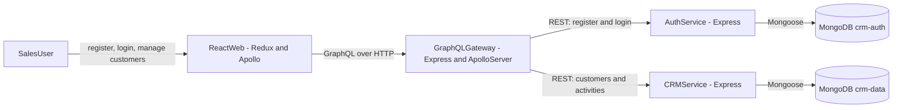

# Atlas Production CRM

Atlas is a CRM monorepo (npm workspaces) with a React frontend, a GraphQL API gateway, and separate auth and CRM services backed by MongoDB. It also includes Docker, tests, GitHub Actions, and Terraform for AWS.

What works today:

- Register / login (bcrypt + JWT)
- Per-user customer isolation
- Create, list, and delete customers in the UI
- Update customers and add activities via the API
- Statuses: `lead`, `active`, `inactive`
- Activity types: `note`, `call`, `email`, `meeting`
- Local run with npm or Docker Compose
- Lint, format, test, build, audit, and infra checks in CI
- Deploy to AWS ECS Fargate

> Longer write-up (design choices, data model, security notes, limitations):
> [docs/PROJECT_RESEARCH.md](docs/PROJECT_RESEARCH.md).

## Table of contents

1. [System overview](#system-overview)
2. [Technology stack](#technology-stack)
3. [Repository structure](#repository-structure)
4. [Architecture](#architecture)
5. [Business logic](#business-logic)
6. [Application components](#application-components)
7. [Data model](#data-model)
8. [API surface](#api-surface)
9. [Security model](#security-model)
10. [Local development](#local-development)
11. [Configuration](#configuration)
12. [Testing and quality](#testing-and-quality)
13. [Docker architecture](#docker-architecture)
14. [AWS deployment](#aws-deployment)
15. [Known limitations](#known-limitations)

## System overview

Request path:

1. Browser loads the React SPA.
2. Apollo Client talks GraphQL to the API gateway.
3. Gateway checks auth, then calls internal REST services.
4. Auth service owns users, password hashes, and JWT issuance.
5. CRM service owns customers and embedded activities.
6. MongoDB holds auth and CRM data in separate databases.

The browser never hits MongoDB or the internal services directly. In Docker/AWS, only the web app and gateway should be public.

## Technology stack

| Area            | Technology                           | Purpose                                 |
| --------------- | ------------------------------------ | --------------------------------------- |
| Monorepo        | npm workspaces                       | Apps + shared packages                  |
| Frontend        | React 18 + TypeScript                | UI                                      |
| Build tool      | Vite 5                               | Dev server and frontend build           |
| Client state    | Redux Toolkit                        | Auth session                            |
| Server state    | Apollo Client                        | GraphQL + cache                         |
| Public API      | GraphQL + Apollo Server              | Browser-facing API                      |
| Gateway runtime | Express 4                            | HTTP + middleware                       |
| Internal APIs   | Express REST                         | Gateway ↔ services                      |
| Authentication  | JWT HS256 + bcryptjs                 | Identity and password hashing           |
| Validation      | express-validator                    | Input checks at service boundaries      |
| Persistence     | MongoDB 7 + Mongoose 8               | Users, customers, activities            |
| Shared domain   | `@crm/shared`                        | Statuses, roles, activity types, limits |
| Tests           | Vitest, Supertest, Testing Library   | Unit, HTTP, component tests             |
| Code quality    | ESLint + Prettier                    | Lint and format                         |
| Containers      | Docker + Docker Compose              | Local and production images             |
| Cloud           | AWS ECS Fargate, ALB, ECR, Cloud Map | Runtime and routing                     |
| Operations      | CloudWatch + Secrets Manager         | Logs, alarms, secrets                   |
| Infrastructure  | Terraform                            | AWS provisioning                        |
| CI/CD           | GitHub Actions + AWS OIDC            | Checks and deploy                       |

## Repository structure

```text
production-crm/
├── apps/
│   ├── web/                 React, Redux, Apollo
│   ├── api-gateway/         Public GraphQL API
│   ├── auth-service/        Register, login, JWT
│   └── crm-service/         Customers and activities
├── packages/
│   └── shared/              Shared domain constants
├── docs/
│   ├── API.md               Internal API notes
│   ├── AWS_DEPLOYMENT.md    AWS setup / deploy
│   └── PROJECT_RESEARCH.md  Longer project notes
├── infra/
│   └── terraform/           ECS, ALB, ECR, etc.
├── .github/
│   ├── workflows/ci.yml
│   ├── workflows/deploy-aws.yml
│   └── dependabot.yml
├── docker-compose.yml
├── package.json
└── README.md
```

## Architecture

### Logical architecture



### Why GraphQL and REST

The browser gets one GraphQL API. The gateway is a BFF: it hides service URLs and the internal REST shape. Auth and CRM stay as small REST services so they can be built, tested, and deployed on their own.

### Who owns what

- Redux: `user` + `token`
- `localStorage` key `crm.session`: session persistence (shape-checked on boot; the client does not re-verify the JWT)
- Apollo: customer queries and cache updates after mutations
- Auth service: user records
- CRM service: customers and activities
- Gateway: no database

## Business logic

### End-to-end flow

```mermaid
flowchart TD
    Start[OpenApplication]
    Session{StructurallyValidSavedSession}
    AuthScreen[ShowLoginOrRegistration]
    Credentials[SubmitCredentials]
    AuthMutation[GraphQLLoginOrRegister]
    AuthService[ValidateAndAuthenticate]
    Token[IssueEightHourJWT]
    Dashboard[ShowCustomerDashboard]
